# Hi, I'm Sahaj 👋

### Aspiring Developer | Learning by Building

I believe in learning through practice, building real projects, and improving one step at a time.

 

---

## `$ whoami`

* 🎓 **Currently:** Exploring software development
* 🌱 **Learning:** Web development, Python, and DSA
* 🛠️ **Building:** Practical projects to strengthen my skills
* 💡 **Interests:** Clean UI, problem-solving, and technology
* 🎯 **Goal:** Become a confident, well-rounded developer

 

---

## `$ tech-stack`

**Languages & Web**

  
  
  
  
  

**Tools & Workflow**

  
  
  

---

## `$ contribution-activity`

---

## `$ current-mindset`

> Learn consistently. Build intentionally. Improve continuously.

**Thanks for visiting my profile!**

*Every project is another step forward.*

